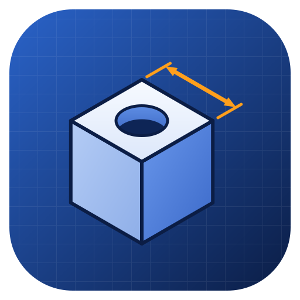
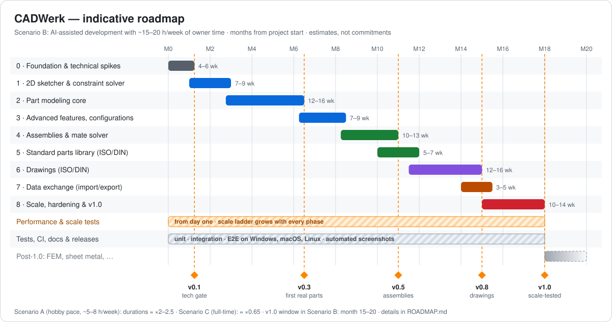

  

<h1 align="center">CADWerk</h1>

  <strong>Parametric 2D/3D CAD for the desktop: parts, assemblies, standard parts and drawings.</strong> 
  Cross-platform (Windows · macOS · Linux) · built with Node.js and Electron · English and German UI

  
  
  
  

> [!WARNING]
> **CADWerk is in the planning stage. There is no usable release yet.**
> Please read the [disclaimer](#disclaimer) before you use anything from this repository.

---

## Contents

- [What is CADWerk?](#what-is-cadwerk)
- [Disclaimer](#disclaimer)
- [Planned features](#planned-features)
- [Design approach](#design-approach)
- [Technology](#technology)
- [Quality and performance from day one](#quality-and-performance-from-day-one)
- [Roadmap](#roadmap)
- [Planned packages](#planned-packages)
- [Documentation and screenshots](#documentation-and-screenshots)
- [License](#license)

## What is CADWerk?

CADWerk is a desktop CAD application for designing mechanical parts and assemblies. It follows the
**feature-based, history-driven workflow** that professional mechanical CAD systems use:

1. **Sketch** a fully constrained 2D profile.
2. **Build features** such as extrudes, revolves, fillets and hole patterns into a solid part.
3. **Assemble** parts and ISO/DIN standard parts (screws, nuts, washers, pins) with mates.
4. **Derive drawings** that follow ISO/DIN conventions, either automatically or by hand.
5. **Export** to the formats manufacturing needs: 3MF, STL, STEP, DXF, PDF and more.

The goal is not to clone any commercial product. The goal is a focused, fast and dependable tool for
makers, students and small workshops that covers the everyday mechanical design workflow very well.

## Disclaimer

> [!CAUTION]
> **CADWerk is under active development.** It is not finished, not stable and not suitable for productive
> or commercial use. Features can be missing, behave incorrectly or change at any time, and files created
> with development versions may not open in later versions. Use it at your own risk.

- **Early development.** CADWerk is an independent project in an early stage of development. Features
  may be incomplete, change without notice or contain errors. Do not use it for productive work yet,
  and always keep backups of your files.
- **No warranty.** The software is provided **"as is"**, without warranty of any kind, express or implied,
  including but not limited to fitness for a particular purpose. The authors are not liable for any
  damage, data loss, faulty parts, production costs or other consequences resulting from its use.
- **You are responsible for your designs.** Geometry, dimensions, tolerances, mass properties,
  standard-part data, drawings and exported files must be checked by a qualified person before anything
  is manufactured, ordered or used. CADWerk is **not** certified for safety-critical applications.
- **Standards.** Standard parts and drawing conventions are implemented to the best of our knowledge from
  publicly available information. They do not replace the official ISO, EN and DIN standards, which are
  published by the respective standards bodies. CADWerk makes no claim of conformity with any standard.
- **File compatibility.** Import and export of third-party file formats is provided on a best-effort basis.
  Exchanged data can lose information or differ from the original.
- **Trademarks.** SOLIDWORKS is a registered trademark of Dassault Systèmes SolidWorks Corporation.
  AutoCAD is a registered trademark of Autodesk, Inc. All other product names and trademarks belong to
  their respective owners. CADWerk is **not affiliated with, endorsed by or sponsored by** any of these
  companies. Product names are mentioned for descriptive purposes only.
- **Third-party software.** CADWerk will build on open-source components (for example Open CASCADE
  Technology). Their licenses and notices will be listed in the application and in this repository.

## Planned features

> Everything below is **planned**. Each item will move to "available", with screenshots, once it ships.

### 2D sketcher
- Lines, arcs, circles, rectangles, slots, polygons, ellipses, splines, points and construction geometry
- Trim, extend, offset, mirror, sketch fillet and chamfer, sketch patterns, project and convert edges
- Geometric relations (coincident, horizontal, vertical, parallel, perpendicular, tangent, concentric,
  equal, symmetric, midpoint, fix) and dimensions (one tool, type inferred from the selection)
- Live constraint solving with clear status colors for under-, fully and over-defined sketches
- Snapping and inference lines while drawing, automatic relations, global variables and equations

### Part modeling
- Feature tree with rollback bar, suppress, reorder and edit-in-place
- Extrude and cut (blind, through all, up to surface, mid-plane, thin), revolve, sweep, loft
- Fillet, chamfer, shell, draft, rib, hole feature with ISO metric threads, linear, circular and mirror patterns
- Reference planes, axes, points and coordinate systems; multi-body parts
- Configurations and design tables, materials, mass properties, measuring and section views

### Assemblies
- Components and sub-assemblies with standard, advanced and mechanical mates
- Dragging that respects mates, degree-of-freedom analysis, interference and clearance checks
- Component patterns, exploded views and bills of materials (BOM)
- Large-assembly mode with instancing, so assemblies with thousands of fasteners stay smooth

### Standard parts library (ISO / DIN)
- A large catalog of screws, nuts, washers, pins, bolts, retaining rings, keys and threaded rods
  (for example ISO 4762 / DIN 912, ISO 4017 / DIN 933, ISO 4032 / DIN 934, ISO 7089 / DIN 125, ISO 2338 / DIN 7)
- Search and filter, drag and drop into assemblies, automatic mates into holes and fastener stacks
- Proper designations in the BOM, for example `ISO 4762 - M8 x 30 - 8.8`

### Drawings
- Sheet formats A4–A0 with ISO title blocks; first-angle projection (ISO standard) by default
- Standard, projected, isometric, section, detail, broken-out, break and auxiliary views
- Dimensions, tolerances and fits, geometric tolerances, surface texture symbols, center lines and thread display
- Balloons and parts lists for assembly drawings
- Automatic drawing creation that places views and model dimensions for you, then manual refinement
- Drawings stay associative: when the model changes, the drawing updates

### Import and export
| Format | Import | Export | Typical use |
|---|:---:|:---:|---|
| CADWerk native (`.cwpart`, `.cwasm`, `.cwdrw`) | ✓ | ✓ | Your working files |
| STEP (AP203 / AP214 / AP242) | ✓ | ✓ | Exchange with other CAD systems |
| 3MF | ✓ | ✓ | 3D printing, with colors and multiple objects |
| STL | ✓ (mesh) | ✓ | 3D printing |
| IGES | ✓ | ✓ | Legacy CAD exchange |
| DXF | ✓ | ✓ | Laser cutting, CNC, 2D exchange |
| PDF | – | ✓ | Vector drawings at true scale |
| SVG, PNG | – | ✓ | Documentation |
| glTF / GLB, OBJ | – | ✓ | Visualization |

DWG is not supported because it is a closed, proprietary format. DXF is the open format for 2D exchange
and is read by all common CAD programs.

## Design approach

**Proven functionality, independent implementation.** CADWerk offers the capabilities that experienced
mechanical designers rely on in feature-based CAD, but it is not a copy of any product. All source code,
tests, user interface, icons and visual design are CADWerk's own work. No code, assets or UI designs from
other products are used.

What you can expect:

- An **independent, modern visual design** with light and dark themes and its own icon set
- A **feature tree** that records how a part was built and lets you roll back, suppress and reorder
- **Contextual property panels** with live preview while you create or edit a feature
- An **efficient, mouse-driven workflow**: view cube, standard and section views, mouse gestures,
  customizable shortcuts and a searchable command palette
- A UI in **English and German**, switchable at runtime (default: system language)

## Technology

| Area | Planned technology |
|---|---|
| Application shell | Electron with secure defaults (context isolation, sandbox, no Node integration in the renderer), single instance |
| Language | TypeScript (strict) |
| Geometry kernel | [Open CASCADE Technology](https://dev.opencascade.org/) (B-Rep modeling, booleans, fillets, STEP/IGES), compiled to WebAssembly and running in worker threads |
| Sketch solver | Geometric constraint solver compiled to WebAssembly (candidate: PlaneGCS) |
| Assembly solver | Rigid-body mate solver with degree-of-freedom analysis |
| 3D viewport | three.js (WebGL 2, WebGPU later) with GPU picking, instancing and level of detail |
| Testing | Vitest, Playwright for Electron, geometry golden tests, visual regression, benchmark suite |
| Packaging | electron-builder and GitHub Actions |

The architecture and all technology choices are explained in [ROADMAP.md](ROADMAP.md#architecture-overview).

## Quality and performance from day one

- **Automated tests from the first commit:** unit, integration and end-to-end UI tests, run in CI on
  Windows, macOS and Linux.
- **Performance tests from the first commit:** every phase adds larger sketches, more complex parts and
  bigger assemblies to a **scale ladder**, from 10 components at the start to tens of thousands of instanced
  components before v1.0. Regressions fail the build.
- **Measured, not assumed:** performance budgets (frame rate, rebuild time, load time, memory) are tracked
  on real hardware and published with each release.

## Roadmap

  

| Phase | Content | Milestone |
|---|---|---|
| 0 | Foundation and technical spikes: app shell, kernel, CI, packaging, test and benchmark harness | v0.1 – tech gate |
| 1 | 2D sketcher and constraint solver | v0.2 |
| 2 | Part modeling core, native files, STL / 3MF / STEP export | v0.3 – first real parts |
| 3 | Advanced features and configurations | v0.4 |
| 4 | Assemblies and mate solver | v0.5 |
| 5 | Standard parts library (ISO / DIN) | v0.6 |
| 6 | Drawings (ISO / DIN), PDF and DXF export | v0.8 |
| 7 | Complete data exchange | v0.9 |
| 8 | Scale, hardening, documentation | v1.0 |
| Post-1.0 | FEM, sheet metal, weldments, surfaces, motion | – |

The detailed plan, with effort estimates, performance targets, risks and decision gates, is in **[ROADMAP.md](ROADMAP.md)**.

## Planned packages

Every release will be built and published automatically by GitHub Actions:

| Platform | Packages | Architectures |
|---|---|---|
| Windows | Installer (NSIS), portable | x64, arm64 |
| macOS | `.dmg`, `.zip` | Universal, Apple Silicon (arm64), Intel (x64) |
| Linux | AppImage, `.deb`, `.rpm`, pacman, Snap, Flatpak, `.tar.gz` | x64, arm64 |

## Documentation and screenshots

Each feature gets a detailed user guide with screenshots. Screenshots are produced automatically by the
end-to-end test suite, so they always match the current version. The documentation grows with each
release; see [CHANGELOG.md](CHANGELOG.md) for what has changed.

## License

CADWerk is free software: you can redistribute it and/or modify it under the terms of the
**GNU General Public License** as published by the Free Software Foundation, either **version 3** of the
License, or (at your option) any later version. See [LICENSE](LICENSE) for the full text.

CADWerk is distributed in the hope that it will be useful, but WITHOUT ANY WARRANTY; without even the
implied warranty of MERCHANTABILITY or FITNESS FOR A PARTICULAR PURPOSE.
