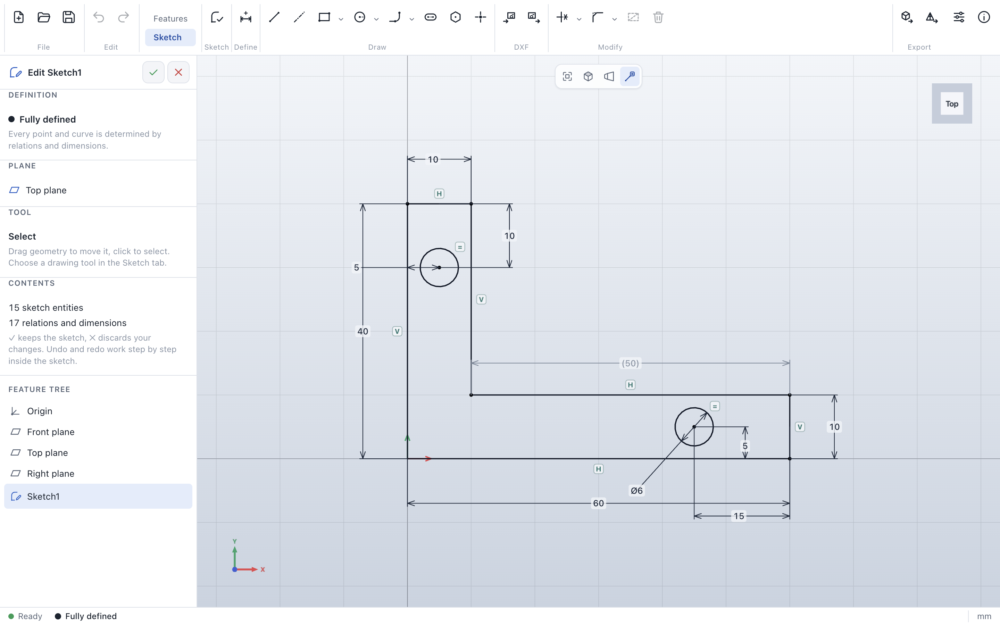
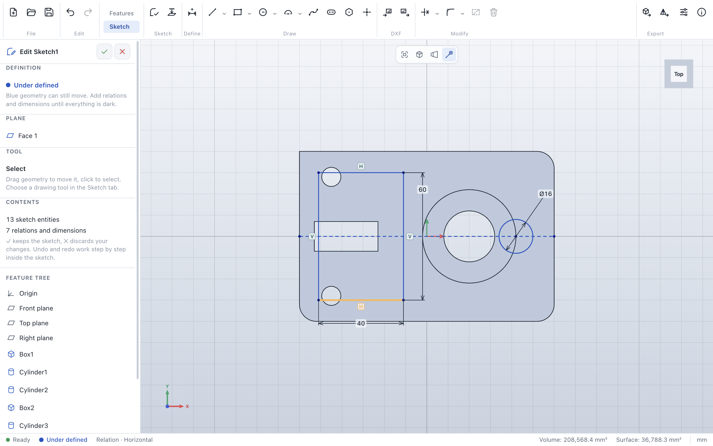
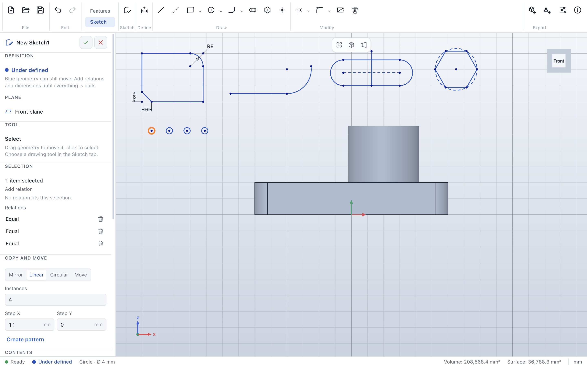
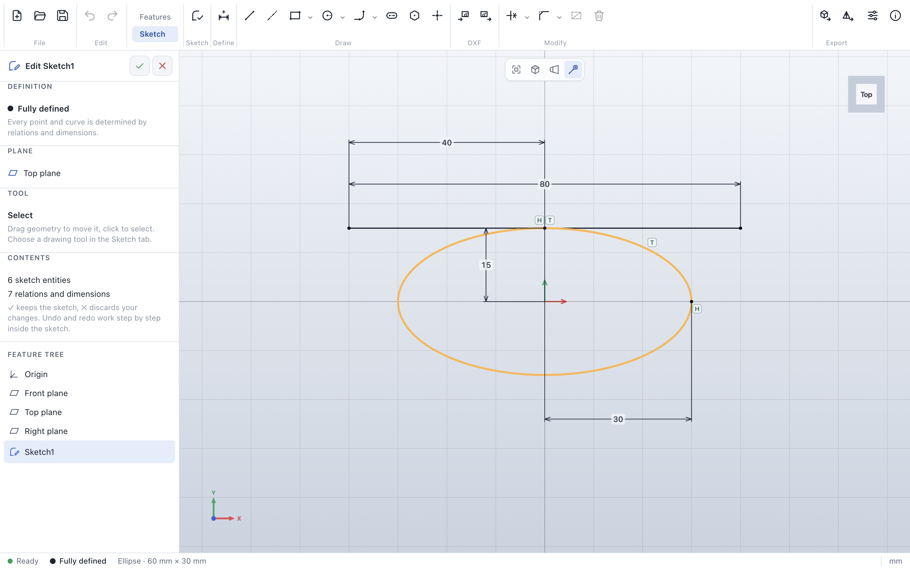

# ParaWerk 0.2.0-alpha.0 – the 2D sketcher

The second technical preview brings the **2D sketcher** (Phase 1 of the [roadmap](../../ROADMAP.md)): draw
profiles, constrain them with relations and dimensions until they are fully defined, edit them with the
usual sketch tools and exchange them as DXF. Turning sketches into solids (extrude, revolve) follows in
Phase 2, so this is still a preview to try out, not a tool for real parts.

## Highlights

### Draw

Lines and centerlines, four kinds of rectangles (corner, center, 3-point at any angle, parallelogram),
circles (center or three points), ellipses, arcs (center, three points, tangent), slots, regular polygons
and points. The cursor snaps to end points, midpoints and curves and lines up with other points; the
matching relations are added as you draw, and the current length, angle or radius is shown next to the
cursor. Keyboard shortcuts: **L** line, **R** rectangle, **C** circle, **A** arc, **P** point,
**D** dimension, **T** trim.

### Define: relations, dimensions and the definition status

Select geometry and the side panel offers the relations that fit – horizontal, vertical, coincident, on
curve, midpoint, parallel, perpendicular, collinear, equal, tangent, concentric, symmetric and fix.
The **smart dimension** tool infers the dimension from what you pick and where you place the value; you
type the value right at the dimension. The solver checks everything first: a relation that would
over-define the sketch is refused, a dimension that already follows from the others becomes a reference
dimension in parentheses. Blue geometry can still move, dark geometry is fully defined, conflicts are red
and listed in the side panel.

| Relation symbols: point at one to see what it relates | Conflicts are red and can be deleted |
|---|---|
|  |  |

### Edit

**Trim** removes the piece of a curve between its crossings (shown in red before you click), **extend**
lengthens lines and arcs up to the next curve. **Sketch fillet and chamfer** round or bevel corners and
keep them dimensionable. **Offset**, **mirror**, **linear and circular patterns**, **move** and **copy**
work on the selection. Under-defined geometry can be dragged while the solver keeps every relation.

| Trim with preview | Linear pattern of a hole |
|---|---|
|  |  |

### Ellipses

An ellipse is defined by its center and the ends of its two axes; dimension the semi-axes from the center.
Points can lie on ellipses and lines can be tangent to them.

### DXF for laser cutting and CNC

Import the 2D geometry of a DXF file into a sketch (units are converted, touching ends joined) and
export a sketch as DXF R12 in millimeters, without construction geometry.

### Made to stay fast

The solver runs in a background worker. On an Apple M3, a mouse movement costs:

| Sketch entities | Dragging geometry | Drawing a line (snapping and preview) |
|---|---|---|
| 50 | 6.8 ms | 2.9 ms |
| 500 | 6.5 ms | 3.6 ms |
| 2,000 | 7.7 ms | 4.5 ms |

An automated test draws and fully defines the bracket above with mouse and keyboard only, in the smallest
window, and fails if it takes more than 64 clicks and key presses.

## Which file do I need?

| System | Download |
|---|---|
| Windows 10/11 (Intel/AMD) | `ParaWerk-0.2.0-alpha.0-win-x64-setup.exe` (installer) or `…-win-x64-portable.exe` |
| Windows on ARM | `ParaWerk-0.2.0-alpha.0-win-arm64-setup.exe` or `…-win-arm64-portable.exe` |
| macOS (Apple Silicon and Intel) | `ParaWerk-0.2.0-alpha.0-mac-universal.dmg` (or `…-mac-arm64.dmg` / `…-mac-x64.dmg`) |
| Linux | AppImage, `.deb`, `.rpm`, `.pacman`, Snap, Flatpak or `.tar.gz` for x64 (`x64`, `x86_64`, `amd64`) or arm64 (`arm64`, `aarch64`) |

The builds are not signed with a developer certificate yet, so the system asks once before the first
start. [Getting started](../user-guide/getting-started.md#install) shows how to confirm on each system.
New in this release: the macOS app carries a complete ad-hoc signature, so macOS offers *Open Anyway*
instead of calling the app damaged.

## Known limitations

- Sketches cannot be extruded or revolved yet (Phase 2).
- Splines, projecting model edges into a sketch, scaling and equations are still missing.
- Ellipses can only be trimmed as a whole; offset leaves them out.
- DXF import skips splines, elliptical arcs, texts, dimensions, hatches and blocks (a message lists them).

Read the [sketches chapter of the user guide](../user-guide/sketches.md) for every tool, with a
step-by-step example.
