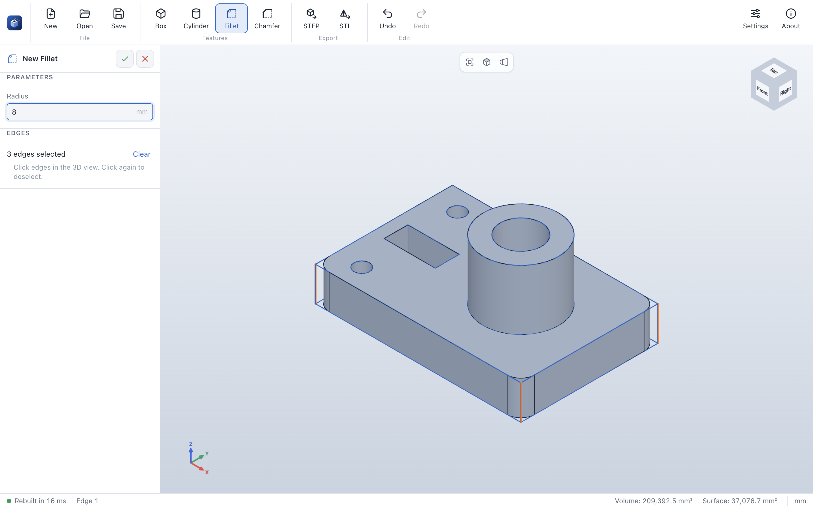
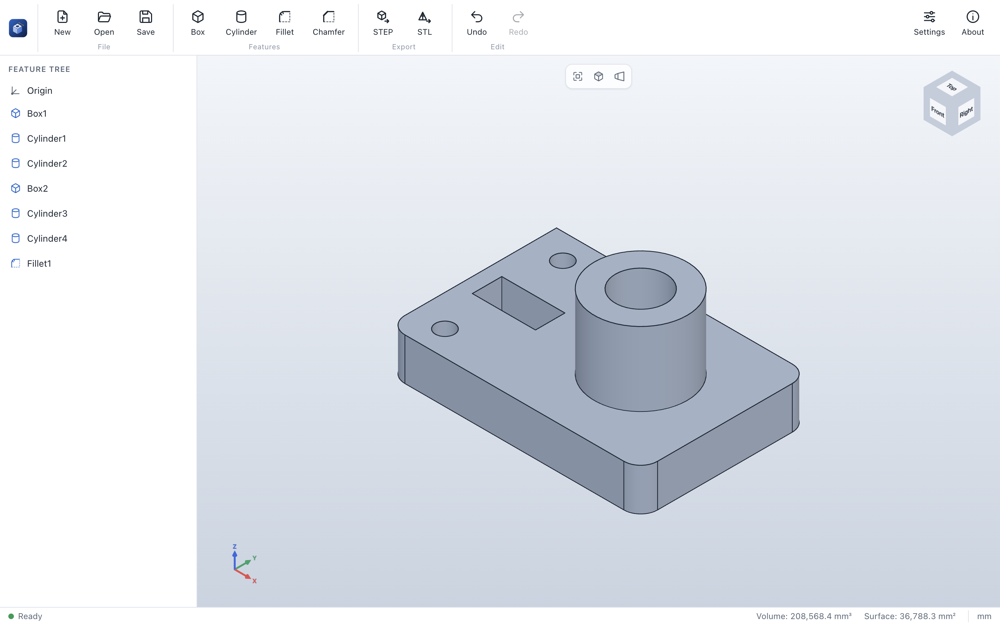

# Getting started

## Install

Download the package for your system from the
[releases page](https://github.com/Ujap1994/ParaWerk/releases):

| System | Recommended package |
|---|---|
| Windows 10/11 | `ParaWerk-<version>-win-x64-setup.exe` (or `-arm64-` on ARM devices); a portable `.exe` needs no installation |
| macOS 12 or later | `ParaWerk-<version>-mac-universal.dmg` (runs natively on Apple Silicon and Intel) |
| Linux | AppImage (any distribution), `.deb` (Debian, Ubuntu), `.rpm` (Fedora, openSUSE), `.pacman` (Arch), Snap, Flatpak or `.tar.gz`, each for x64 and arm64 |

> [!NOTE]
> Preview builds are not code-signed yet.
> - **macOS:** right-click ParaWerk in *Applications*, choose *Open* and confirm once.
> - **Windows:** in the SmartScreen dialog choose *More info* → *Run anyway*.

ParaWerk starts in your system language (English or German). You can change it any time in
**Settings**.

## Your first part

This walk-through builds a plate with a hole and rounded corners and exports it for 3D printing.

1. **Create the base.** Click **Box** in the command bar. The property panel on the left shows the box
   parameters with a live preview. Set *Width* to `120`, *Depth* to `80` and *Height* to `20`, then
   confirm with **✓** (or press **Enter**).
2. **Drill a hole.** Click **Cylinder**, choose **Remove material**, set *Radius* to `12` and
   *Height* to `40`. Under *Position*, set *Z* to `-10` so the cylinder passes through the plate.
   Confirm with **✓**.
3. **Round the corners.** Click **Fillet** and click the four vertical corner edges in the 3D view.
   Selected edges turn orange; the result is previewed immediately. Set *Radius* to `8` and confirm.

   

4. **Check the result.** The status bar shows the exact volume and surface area. Hover over a face or
   edge to see its number.
5. **Save.** Click **Save** (Ctrl+S / ⌘S) and choose a name. Parts are stored as `.pwpart` files.
6. **Export.** Click **STL** to export for a slicer, or **STEP** to exchange the part with other CAD
   systems.

