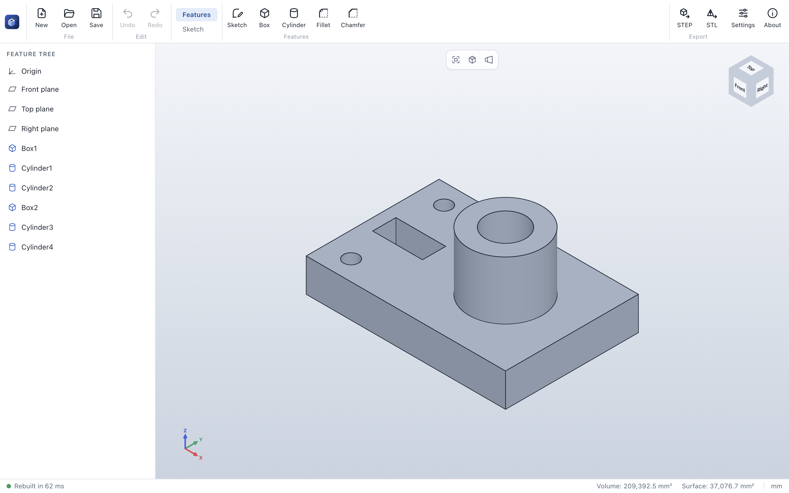

# The interface

| Area | Purpose |
|---|---|
| **Command bar** (top) | *File* and *Edit* commands on the left, *Export*, *Settings* and *About* on the right. In between, the tabs **Features** and **Sketch** switch the command set; entering sketch mode switches to the *Sketch* tab automatically. Hover over a command to see what it does and its shortcut. |
| **Feature tree** (left) | The origin, the three standard planes and the history of the part, from top to bottom. Hover over a plane to show it in the 3D view; hover over a feature to edit, suppress or delete it; double-click to edit. Features with a rebuild error are shown in red with a warning icon. |
| **Property panel** (left, replaces the tree while a feature is created or edited) | Parameters of the feature with live preview. **✓** (Enter) applies, **✕** (Esc) cancels. |
| **Sketch panel** (left, above the tree in sketch mode) | The open sketch, its plane and contents. **✓** keeps the sketch, **✕** discards the changes. See [Sketches](sketches.md). |
| **3D view** (center) | The model. The floating toolbar offers *Zoom to fit*, *Standard views* and *Perspective*. The view cube (top right) and the axis indicator (bottom left) show the orientation. |
| **Status bar** (bottom) | Kernel state and rebuild time; the face or edge under the cursor (or the selected one) with its exact geometry, for example *Face 7 · Cylinder Ø 44 mm · 4,838.1 mm²*; volume and surface area of the part; optional frame statistics; the unit (mm). |

## Keyboard shortcuts

| Action | Windows / Linux | macOS |
|---|---|---|
| New part | Ctrl+N | ⌘N |
| Open | Ctrl+O | ⌘O |
| Save / Save as | Ctrl+S / Ctrl+Shift+S | ⌘S / ⌘⇧S |
| Undo / Redo (inside a sketch: sketch steps) | Ctrl+Z / Ctrl+Y | ⌘Z / ⌘⇧Z |
| Zoom to fit | F | F |
| Front, back, left, right, top, bottom, isometric | Ctrl+1 … Ctrl+7 | ⌘1 … ⌘7 |
| Apply / cancel the property panel | Enter / Esc | Enter / Esc |
| Clear the selection; cancel the plane choice of the sketch command | Esc | Esc |
| Delete the selected sketch geometry (in sketch mode) | Delete / Backspace | Delete / ⌫ |
| Drawing tools in sketch mode: line, rectangle, circle, arc, point | L, R, C, A, P | L, R, C, A, P |
| Dimension tool in sketch mode | D | D |
| End the current shape, then leave the drawing tool | Esc | Esc |
| Settings | Ctrl+, | ⌘, |

## Selecting

Faces and edges are the exact faces and edges of the model (B-Rep), not mesh triangles: hovering a
cylinder highlights the whole cylindrical face, and the status bar shows its type and size.

Click a face or edge to select it; click again to deselect. Hold **Ctrl**, **Shift** or **⌘** to add to
the selection. Edges selected *before* starting **Fillet** or **Chamfer** are taken over by the command.
