# Sketches

> [!NOTE]
> The sketcher is being built in Phase 1. This page describes what works today: choosing a sketch plane
> or planar face, sketch mode with its grid and its own undo history, the drawing tools with snapping and
> automatic relations, relations, dimensions, selecting, dragging and deleting sketch geometry, and editing
> existing sketches, and the definition status with conflict diagnosis. More drawing and editing tools
> follow; the page grows with them.

A sketch is a 2D drawing on a plane. Sketches are the starting point of most features: in a typical
workflow you sketch a profile, fully define it with relations and dimensions, and then extrude or
revolve it into a solid.

## Planes

Every part has three standard planes through the origin. They are listed in the feature tree below
**Origin**:

| Plane | Contains | Looks along |
|---|---|---|
| **Front plane** | X and Z | +Y (the front view) |
| **Top plane** | X and Y | −Z (the top view) |
| **Right plane** | Y and Z | −X (the right view) |

Hover over a plane in the feature tree to show it in the 3D view. Click it to select it; it stays visible
while it is selected. Planes are hidden otherwise, so they never get in the way.

## Planar faces

Any flat face of the part can carry a sketch, for example the top of a plate or the bottom of a pocket.
The sketch lies exactly in the face's plane (ParaWerk takes the plane from the exact B-Rep geometry, not
from the triangles of the display), and you look at it from outside the material.

- **Sketch origin on a face:** the part origin projected onto the face's plane, as for any plane through
  the part.
- **Sketch axes on a face:** chosen like the standard views, so a face parallel to the front, top or right
  plane gets the same axes as that plane, and on all other faces the sketch's y axis points as close to
  upwards (+Z) as the face allows.
- In this preview a sketch keeps the position of the face at the time it was created; it does not yet
  move along when the face moves because earlier features change. Following the face is part of the
  persistent naming work ([ADR 0002](../adr/0002-persistent-naming.md)).

## Starting a sketch

There are several ways to start a sketch; use whichever fits your hand:

- Click **Sketch** (in the *Features* or the *Sketch* tab of the command bar). The three planes appear in
  the 3D view and the side panel asks for a plane. Click a plane or a planar face in the 3D view, a plane
  in the feature tree or one of the buttons in the panel. What is under the cursor is highlighted in
  orange and named in the status bar; curved faces cannot be picked.
- Select a plane (in the feature tree) or a planar face (in the 3D view) first, then click **Sketch**:
  the sketch opens there at once.
- Hover over a plane in the feature tree and click its **Sketch on this plane** button.

When a translucent plane lies in front of a face, a click picks the face: you see the face through the
plane, so that is what you aim at. Click a plane where it extends beyond the part, or pick it in the
feature tree or the panel.

**Esc** or **✕** cancels the plane choice.

| Choosing a standard plane | Choosing a planar face |
|---|---|
| 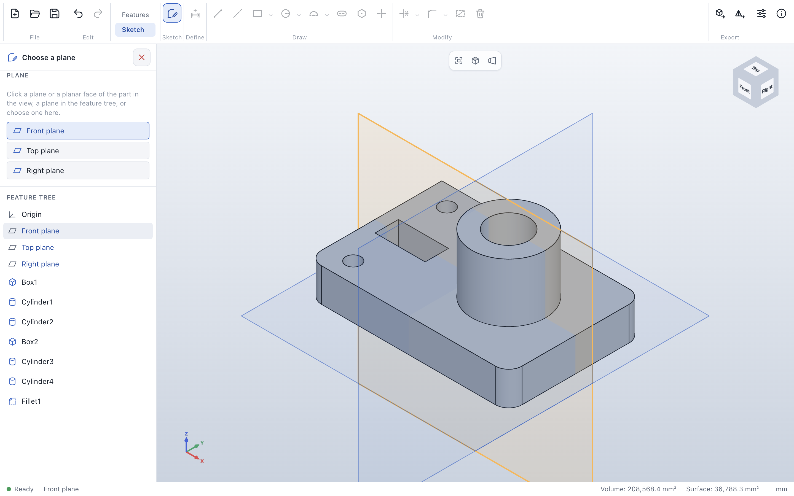 | 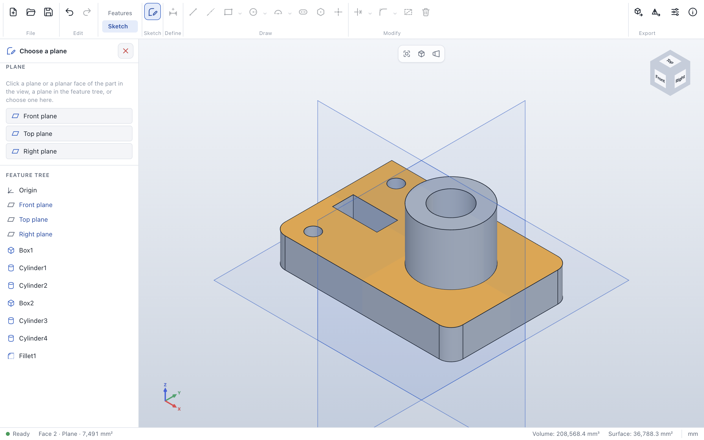 |

## Sketch mode

When the sketch opens, the view turns to look straight at the sketch plane, with the sketch's x axis to
the right and its y axis up. The command bar switches to the *Sketch* tab.

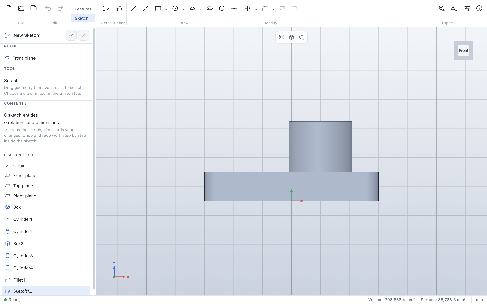

- **Grid:** the sketch plane shows a grid with major lines every ten minor lines. The spacing adapts to
  the zoom level in powers of ten (0.1, 1, 10, 100 mm, ...); finer lines fade in smoothly as you zoom in.
  The two sketch axes are drawn a little stronger. Where the plane runs inside the part, the part hides
  the grid.
- **Sketch origin:** the red (x) and green (y) arrows mark the origin of the sketch. They keep their size
  on screen at every zoom level.
- **Navigation** works as usual: you can rotate, pan and zoom freely. Use the view cube or the standard
  views to look at the sketch from any side.
- **Rolled-back model:** while you edit a sketch, the part is shown as it was *before* the sketch;
  features below the sketch appear faded in the feature tree and are rebuilt when you leave sketch mode.
- **Side panel:** shows the sketch's name, its plane and what it contains. The feature tree stays visible
  below it, but other features cannot be edited, suppressed or deleted until you leave the sketch.

## Drawing

The drawing tools are in the **Sketch** tab of the command bar (and on the keyboard). A tool stays active
until you press **Esc** or choose it again, so you can draw several shapes in a row. The side panel always
explains the active tool.

| Tool | Key | How to draw |
|---|---|---|
| **Line** | L | Click the start point, then each next point: the lines form a connected chain. Clicking the chain's start point closes it; **Esc** or a second click on the last point ends it. Pressing, dragging and releasing draws a single line. |
| **Centerline** | | Like a line, but the result is construction geometry (dashed), for example a symmetry axis. |
| **Rectangle** | R | Click one corner, then the opposite corner (or drag). The sides get horizontal and vertical relations. |
| **Center rectangle** | R | Click the center, then a corner. Dashed diagonals keep the center in the middle. |
| **Circle** | C | Click the center, then a point on the circle (or drag). |
| **3-point circle** | C | Click three points the circle passes through. |
| **Arc** | A | Click the center and the start point, then move in the direction the arc should run and click the end point. |
| **3-point arc** | A | Click the start and the end point, then a third point the arc passes through. |
| **Tangent arc** | A | Click the end point of a line or arc, then where the arc should end. The arc continues the line or arc without a kink (*tangent* relation). |
| **Slot** | | Click the centers of both rounded ends, then move sideways to set the width. Both straight sides are tangent to the equal end arcs. |
| **Polygon** | | Set the number of sides in the side panel (3 to 64), click the center, then a corner. All sides stay equal; the corners lie on a construction circle, which you can dimension. |
| **Point** | P | Click to place sketch points, for example for hole positions. |

**R**, **C** and **A** start the variant you used last; the small arrow next to *Rectangle*, *Circle* and
*Arc* offers all variants.

### Trim and extend

**Trim** (key **T**, in the *Modify* group) removes the piece of a curve between its neighboring
crossings: move the cursor over a curve, and the piece a click would remove turns red. Ends at a crossing
stay on the crossing curve (*on curve* relation); when the piece is in the middle of a line, the two
remaining parts stay *collinear* (arcs keep an *equal* radius). A circle trimmed between two crossings
becomes an arc, and a curve that nothing crosses is removed completely.

**Extend** (in the menu next to *Trim*) lengthens a line or arc up to the next curve: move near the end you
want to extend – a dashed preview shows how far it grows and highlights the curve it runs into – and click.
Ends that are connected to other geometry or held by relations or dimensions are not moved; a message says
why.

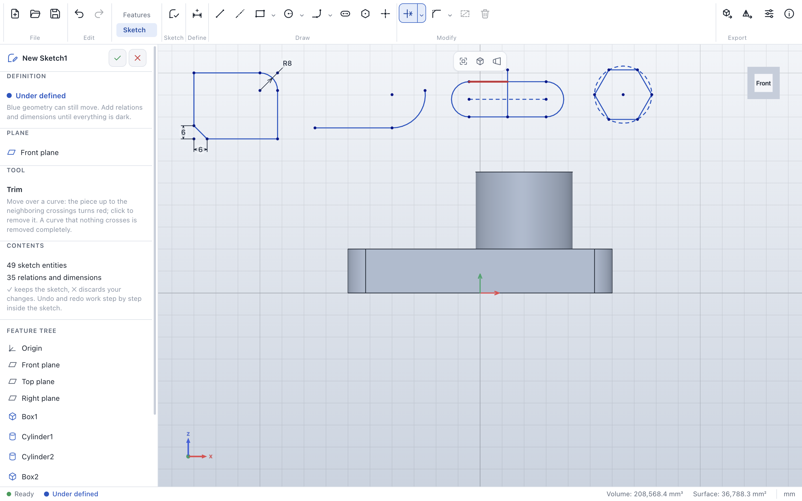

### Fillets and chamfers in a sketch

**Fillet** and **Chamfer** (in the *Modify* group) round or bevel the corner where two lines meet: set the
radius or distance in the side panel, then click corners. The lines are shortened, joined by a tangent arc
(with a radius dimension) or by a line (with both distances dimensioned), and the old corner stays as a
*virtual sharp* on both lines – so dimensions and relations to the corner keep working, and a fully
defined sketch stays fully defined. A radius or distance that does not fit the lines is refused with a
message.

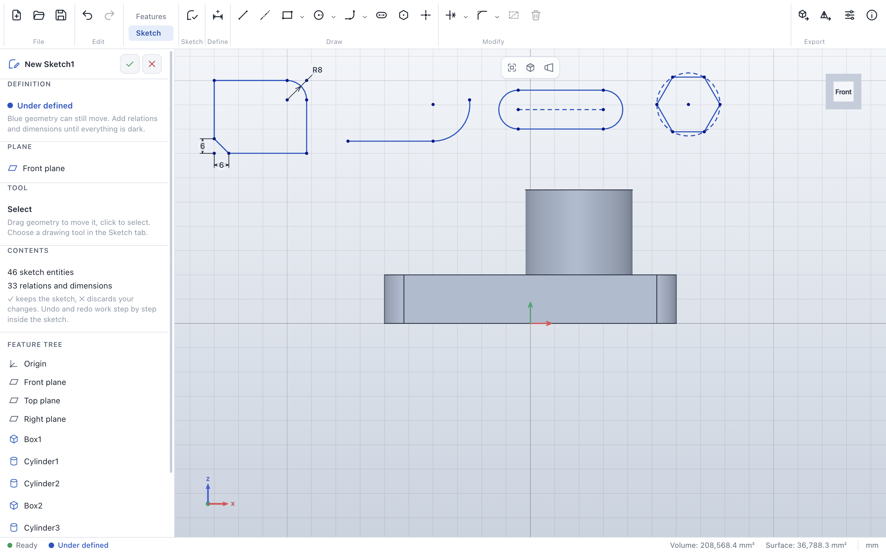

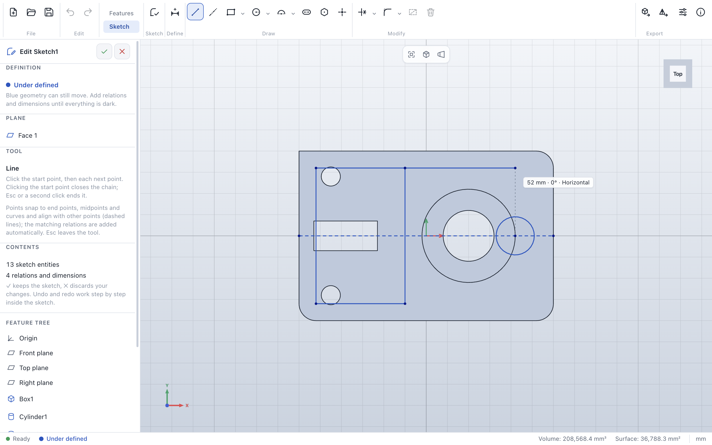

### Snapping and automatic relations

While you draw, the cursor snaps to what is nearby, and the new geometry gets the matching relation, so
your intent is kept when you later change dimensions:

| The cursor snaps to | Marker | Relation of the new point |
|---|---|---|
| An end point, a center or the sketch origin | filled orange dot | the point is shared (*coincident*) |
| The midpoint of a line | orange ring | *midpoint* |
| A line, circle or arc | orange ring | *on curve* |
| Horizontal or vertical from the previous point | dashed line | the new line is *horizontal* or *vertical* |
| Level with or above another point | dashed line | none – it only helps to line things up |

Next to the cursor, ParaWerk shows the size of what you are drawing (length and angle, width × height,
radius and sweep) and the relations it will add.

## Relations

Relations are the geometric rules of a sketch: this line stays horizontal, these two lines stay
parallel, this point stays on that circle. They keep your design intent when dimensions change. Many
relations are added automatically while you draw; others you add yourself:

1. Select the geometry (click, and **Shift**/**Ctrl**/**⌘**-click for more). The sketch origin can be
   selected too.
2. The **Selection** section of the side panel shows the relations that fit the selection. Click one to
   add it; the geometry moves just as much as needed to follow it.
3. Below, the relations the selected geometry already has are listed; the trash button removes one.

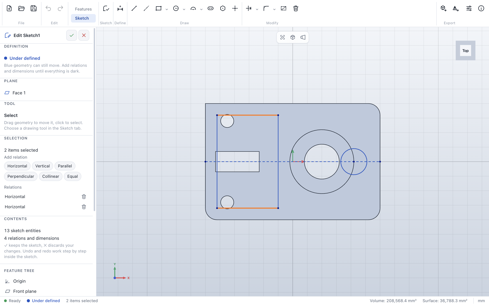

| Selection | Relations offered |
|---|---|
| One or more lines | Horizontal, vertical (for each line); with two or more lines also equal length |
| Two lines | Parallel, perpendicular, collinear, equal length |
| Two points | Horizontal, vertical (aligned with each other), coincident, fix |
| A point and a line | On curve (on the line or its extension), midpoint |
| A point and a circle or arc | On curve |
| Two circles or arcs | Equal radius, tangent, concentric |
| A line and a circle or arc | Tangent |
| Two points and a line | Symmetric about the line |
| Points | Fix (the point does not move anymore) |

ParaWerk checks every new relation with the solver first. A relation that already follows from the
existing relations and dimensions (it would *over-define* the sketch) or contradicts them is refused
with a message, so a sketch never ends up in a state it cannot solve.

## Dimensions

Dimensions give the geometry its sizes. There is one **Dimension** tool (key **D**, in the *Define*
group of the *Sketch* tab); what it measures follows from what you pick and from where you put the value:

1. Click a line, a circle or an arc – or two entities, for example two points, a point and a line, two
   lines or two circles.
2. Move the mouse: the dimension follows and shows the current value. Click where the value should go.
3. Type the value and press **Enter**. The geometry changes so the dimension holds. **Esc** keeps the
   measured value.

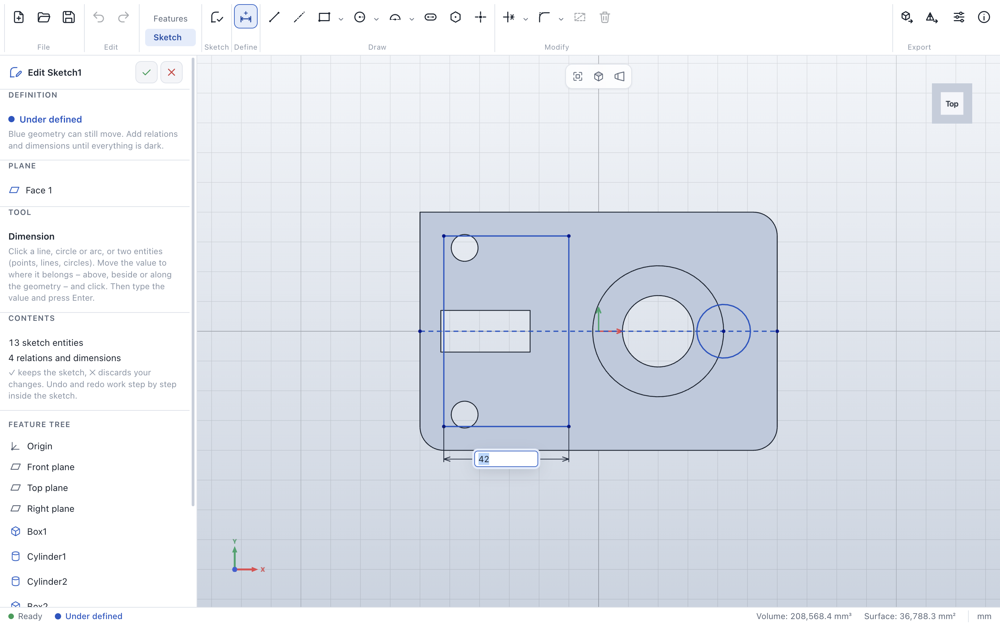

| You pick | Value placed | Dimension |
|---|---|---|
| A line, or two points | above or below | horizontal distance |
| | to the left or right | vertical distance |
| | elsewhere | length / direct distance |
| A circle | anywhere | diameter (Ø) |
| An arc | anywhere | radius (R) |
| A point and a line | anywhere | distance from the point to the line |
| Two lines that cross | anywhere | angle (in degrees) |
| Two parallel lines | anywhere | distance between them |
| Circles and arcs together with points or each other | as for points | distance between the centers |

The sketch origin can be picked as well, so geometry can be dimensioned from the origin.

- **Change a value:** double-click the dimension, type the new value, press **Enter**.
- **Move a value:** drag it; only the label moves.
- **Delete:** click the dimension to select it and press **Delete**.

A dimension that would *over-define* the sketch – because its value already follows from other dimensions
and relations – is added as a **reference dimension**. It shows the measured value in parentheses, for
example *(60)*, updates when the geometry changes, and cannot be edited. If the sketch cannot be solved
with a typed value, ParaWerk keeps the previous value and says so.

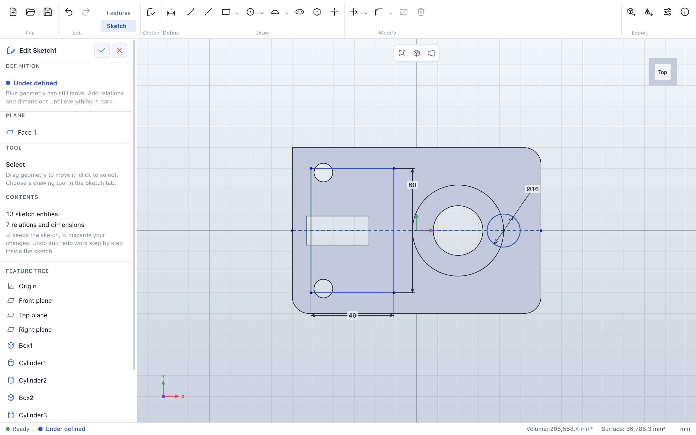

## Fully defined sketches

A sketch is *fully defined* when its relations and dimensions determine every point and curve: nothing
can move anymore. Fully defined sketches keep their shape when you change a dimension, which is what makes
a part reliable to edit. ParaWerk shows the state at all times:

| Color | Status | Meaning |
|---|---|---|
| Blue | **Under defined** | This geometry can still move (try dragging it). Add relations or dimensions. |
| Dark | **Fully defined** | This geometry is completely determined. |
| Red | **Over defined** | Relations or dimensions contradict each other here. |

- The **Definition** section at the top of the side panel and the status bar show the state of the whole
  sketch; each entity has its own color in the 3D view.
- In the feature tree, an under-defined sketch carries a blue ring and an over-defined one a red warning
  sign.
- When a sketch is over defined – for example because it was opened from a file with contradicting
  dimensions – the side panel lists the **conflicting relations and dimensions**, which are also red in
  the view. Delete one of them with its trash button.

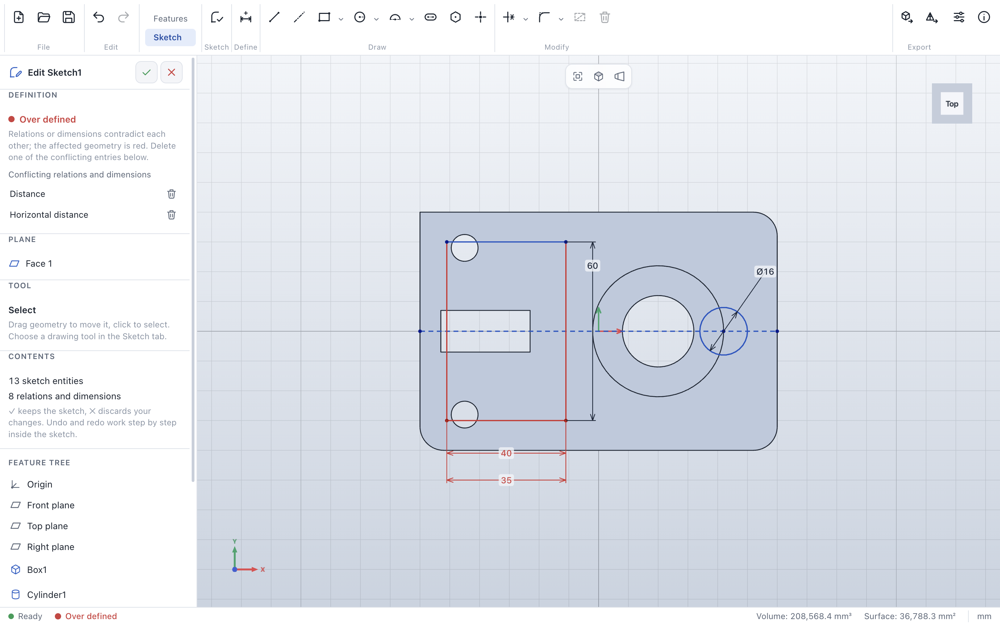

ParaWerk avoids conflicts while you work: relations that contradict the sketch are refused, and
dimensions that would over-define it become reference dimensions.

## Working with sketch geometry

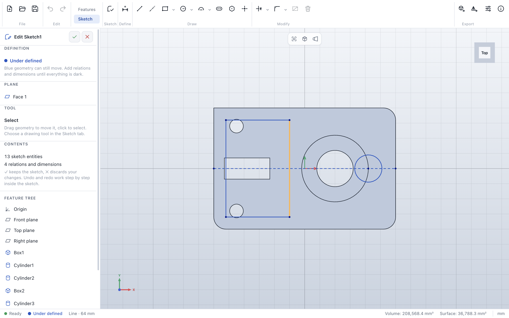

In sketch mode the geometry of the open sketch is drawn in blue on top of the part, so you can see it even
where the sketch plane runs inside the material. Points (end points, centers and stand-alone points)
are shown as dots; construction geometry is dashed.

- **Hover:** the entity under the cursor is highlighted in orange, and the status bar shows its exact
  size: *Line · 64 mm*, *Circle · Ø 18 mm*, *Arc · R 10 mm · 180°* or *Point · X 12 · Y 5*. Points take
  precedence over the curves they belong to, so end points and centers are always easy to grab.
- **Select:** click an entity. Hold **Ctrl**, **Shift** or **⌘** to add or remove entities; click empty
  space or press **Esc** to clear the selection.
- **Drag:** drag a point, a line or an arc to move it, or the edge of a circle to change its radius. The
  geometry follows the cursor while all relations stay satisfied; a rectangle stays a rectangle when you
  drag one of its corners. Geometry that is fully defined (for example fixed) does not move. Each drag is
  one undo step.
- **Delete:** **Delete** or **Backspace** removes the selected geometry, together with relations that
  refer to it. A deleted line takes its own end points with it; corners it shares with other lines stay.

Dragging stays fluid in large sketches: the solver runs in the background, and each drag step (solving,
updating the display and drawing the frame) takes about 7 ms with 500 and with 2,000 entities on an
Apple M3, well within the 16.7 ms of a 60 Hz display.

### Sketches in the 3D view

After you leave sketch mode, the sketch stays visible on its plane as thin dark lines, with construction
geometry dashed and the part hiding what lies behind it. Suppressed sketches are hidden, and so are
sketches below the feature you are currently editing.

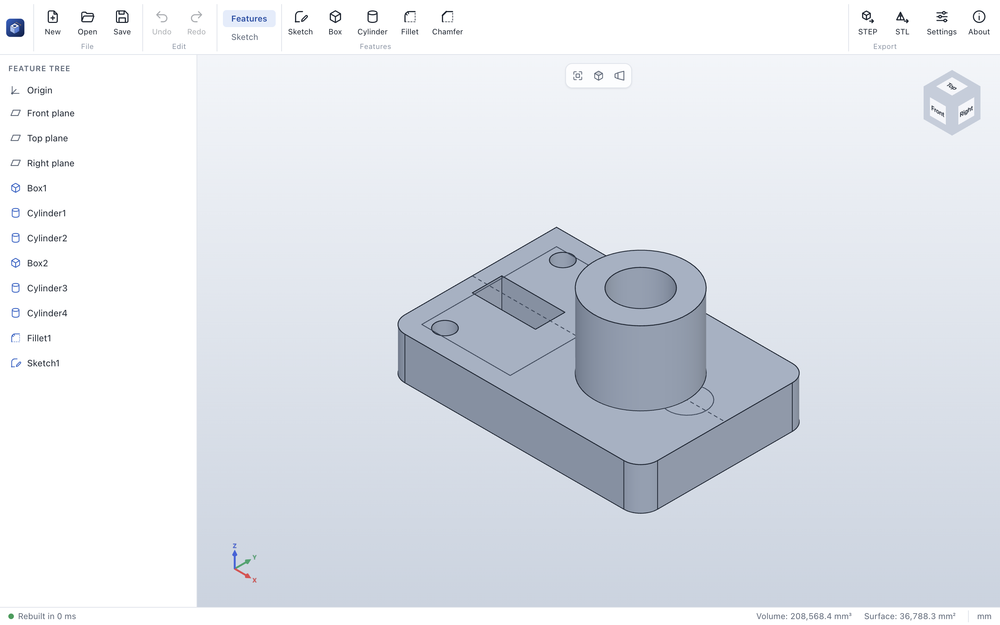

### Undo and redo in sketch mode

Inside a sketch, **Undo** (Ctrl+Z / ⌘Z) and **Redo** (Ctrl+Y / ⌘⇧Z) step through the operations of the
sketch one by one. When you leave the sketch, the whole sketch session becomes a *single* step of the
part's history: one undo afterwards removes (or restores) everything you did in that session.

### Leaving sketch mode

| Action | Result |
|---|---|
| **✓** in the side panel, or **Exit sketch** in the *Sketch* tab | Keeps the sketch. A new sketch is added at the end of the feature tree. A new sketch that is still empty is not added at all. |
| **✕** in the side panel | Discards the changes of this session. If there are changes, ParaWerk asks first. |

Saving (Ctrl+S / ⌘S) while a sketch is open stores the sketch in the file and keeps you in sketch mode.

## Editing a sketch

Double-click a sketch in the feature tree, or hover over it and click **Edit feature**. The sketch opens
in sketch mode on its plane, and everything after it in the feature tree is rolled back until you leave
sketch mode.
